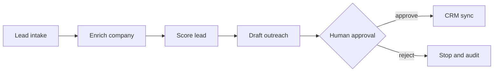

# Human-Approved Lead Qualification Agent

A portfolio project that demonstrates an agentic sales workflow without allowing a model
to perform an uncontrolled external write. The agent validates and enriches a lead,
computes a transparent score, drafts outreach, and pauses for human approval before
syncing to the CRM adapter.

## Workflow



## Safety and engineering decisions

- External writes are isolated behind a CRM adapter.
- The adapter requires an explicit `approved=True` capability.
- The workflow pauses at `awaiting_approval` before any write.
- Invalid repeat approvals return a conflict instead of duplicating records.
- Scoring reasons and every state transition are retained in an audit trail.
- The local demo uses deterministic tools, so tests do not require paid APIs.

## Run

```bash
python -m venv .venv
. .venv/bin/activate
pip install -e '.[dev]'
uvicorn app.api:app --reload
```

Open `http://localhost:8000` for the interactive portfolio demo. The API is available at
`http://localhost:8000/docs`; create a lead with `POST /leads`, inspect the score,
reasons, draft, and audit events, then approve or reject it.

## Deploy

The included `render.yaml` deploys the app as a free Render web service with a health
check. You can also build the included Dockerfile; it honors the platform `PORT` value.

## Verify

```bash
ruff check .
pytest
```

## Production extension points

1. Replace the demo CRM with HubSpot, Salesforce, or another provider adapter.
2. Add real enrichment tools with timeouts, caching, and retry policies.
3. Put an LLM behind a structured draft-generation contract.
4. Persist workflow state and enforce idempotency keys for external writes.
5. Add role-based approval, PII controls, observability, and evaluation datasets.

## Portfolio talking points

- Built a multi-step agent workflow around a real business outcome.
- Added a human-in-the-loop gate before side effects.
- Made qualification scoring explainable rather than hiding it in a prompt.
- Tested state transitions, duplicate approvals, and the write boundary.
